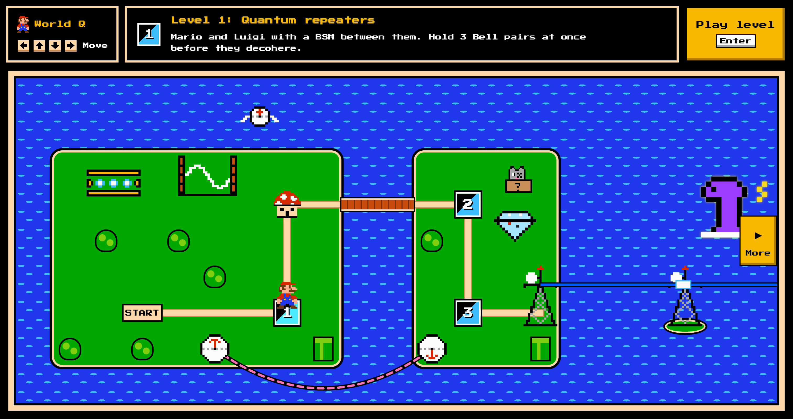
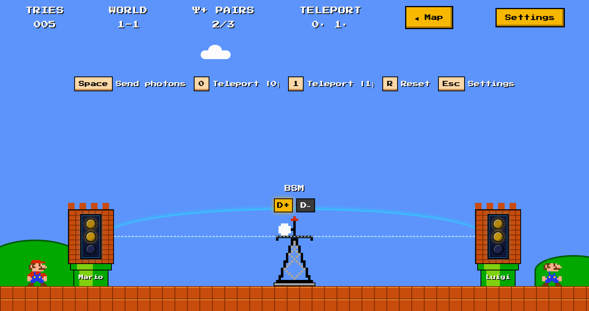
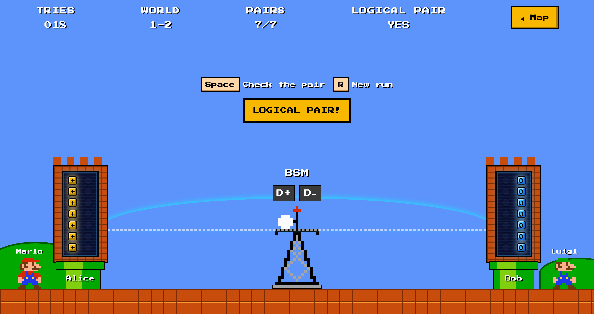
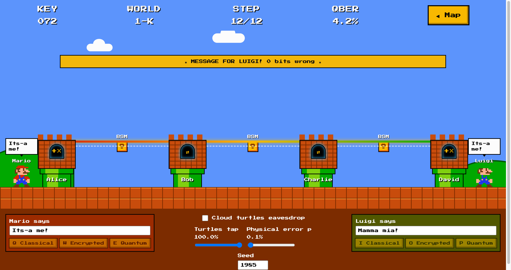

# Quantum Bros

**A Super Mario Bros. 3 style game about the quantum internet**, made for the **Qollab × IonQ Hackathon**.

Mario and Luigi live at opposite ends of the Mushroom Kingdom and want to talk in secret, while Qowser's cloud
turtles listen in on every fiber. Each level teaches one piece of a real protocol, the **quantum repeater with
encoding and classical error correction (QRE-CEC)** [1, 2]: make entanglement with light, protect it with an
error-correcting code, carry it across a chain of repeaters, and turn it into a secret key.



---

## Contents

1. [Play in one minute](#play-in-one-minute)
2. [The big picture](#the-big-picture)
3. [Level 1: Heralded entanglement](#level-1-heralded-entanglement)
4. [Toad's hut: The Steane code](#toads-hut-the-steane-code)
5. [Level 2: A logical Bell pair](#level-2-a-logical-bell-pair)
6. [Level 3: A secret key across a repeater chain](#level-3-a-secret-key-across-a-repeater-chain)
7. [References](#references)

---

## Play in one minute

```sh
cd backend && python3 -m venv .venv && .venv/bin/pip install -e '.[dev]' && cd ..   # once
npm run backend
```

Open **http://localhost:8001**. Walk the map with the arrow keys (or W A S D) and press Enter on a level. Every
level types its goal in the sky and shows, under it, the keys that work right now. Levels 2 and 3 run their quantum
circuits on a Stim stabilizer simulator [11] in the backend; the page plays back what the simulator did.

---

## The big picture

Light is lost in optical fiber exponentially with distance, and a quantum state cannot be copied and amplified. A
**quantum repeater** splits a long distance into short links, builds entanglement on each link, and joins the
links together. QRE-CEC [1, 2] does this with **encoded** (logical) qubits, so the errors made along the way can
be corrected instead of piling up.

Each repeater holds three kinds of qubit (Fig. 1): **communication qubits** that make entanglement with a
neighbour using light, **data qubits** that hold the encoded state, and **ancilla qubits** that check the encoding.

![Fig. 1 of [1]: a quantum repeater with encoding](docs/images/paper-fig1-repeater-qubits.png)

*Fig. 1 of [1]. Communication qubits (gray), data qubits (blue) and ancilla qubits (red). A repeater in the middle
of a chain has one Steane block per neighbour.*

The protocol has five phases, and the game teaches them in order:

| Phase | What happens | Level |
|---|---|---|
| 1 | Heralded entanglement: physical Bell pairs between neighbours (Barrett–Kok) [3] | 1, 2 |
| 2 | Fault-tolerant encoding into Steane blocks (Paetznick–Reichardt encoder, Goto check) [4–6] | Hut, 2 |
| 3 | Transversal teleported CNOT: turns 7 physical pairs into one logical Bell pair [7] | 2 |
| 4 | Encoded swapping with classical error correction at each repeater [2] | 3 |
| 5 | One Pauli-frame correction at the end of the chain [2] | 3 |

![Fig. 2 of [1]: the five phases of QRE-CEC](docs/images/paper-fig2-qre-cec-phases.png)

*Fig. 2 of [1]. (a) Phases 1–3 build an encoded Bell pair on every link. (b) Phases 4 and 5 join the links into one
end-to-end logical Bell pair.*

---

## Level 1: Heralded entanglement



**You play:** Mario and Luigi each have a tower with 3 memory slots, and the telecom tower between them is the
**BSM** (Bell-state measurement station): a beam splitter with two detectors, D+ and D−. Press **Space** to fire a
photon from each tower. When a detector clicks, both towers store a Bell pair Ψ+. **Goals:** fill all 3 slots at
once, and teleport both a **0** and a **1** to Luigi (keys **0** and **1**). **Esc** opens the link settings.

### 1. A qubit that emits a photon

Each memory qubit has two ground states, $\lvert\uparrow\rangle$ and $\lvert\downarrow\rangle$, and an excited
state $\lvert e\rangle$. A laser pulse excites only $\lvert\downarrow\rangle$, which then falls back and emits one
photon. Starting from an equal superposition, the qubit becomes entangled with the photon number of its fiber:

$$\frac{1}{\sqrt 2}\big(\lvert\uparrow\rangle + \lvert\downarrow\rangle\big)\ \longrightarrow\
\frac{1}{\sqrt 2}\big(\lvert\uparrow\rangle\lvert 0\rangle + \lvert\downarrow\rangle\lvert 1\rangle\big).$$

### 2. The beam splitter hides where a photon came from

Both fibers meet at a 50:50 beam splitter, whose outputs feed the detectors:

$$\hat d_\pm = \frac{\hat a_{\text{Mario}} \pm \hat a_{\text{Luigi}}}{\sqrt 2}.$$

A click in D± cannot say which tower sent the photon. If exactly one photon was emitted, the click projects the two
qubits onto

$$\lvert\Psi^\pm\rangle = \frac{1}{\sqrt 2}\big(\lvert\uparrow\downarrow\rangle \pm \lvert\downarrow\uparrow\rangle\big),$$

an entangled Bell pair, even though the two qubits never touched. This is **heralding**: the click announces that
the pair exists.

### 3. Why one click is not enough: Barrett–Kok

Detectors cannot count photons, and photons get lost. If both qubits were $\lvert\downarrow\rangle$, both emit, one
photon is lost, and the other still clicks. After one round the qubits are therefore in a mixture [3]

$$\rho = \frac{1}{N}\lvert\Psi^\pm\rangle\langle\Psi^\pm\rvert + \Big(1-\frac{1}{N}\Big)\lvert\downarrow\downarrow\rangle\langle\downarrow\downarrow\rvert .$$

Barrett and Kok remove the bad term with a second round [3]:

1. Flip both qubits ($X\otimes X$): $\lvert\downarrow\downarrow\rangle \to \lvert\uparrow\uparrow\rangle$, which
   cannot emit at all, while $\lvert\Psi^\pm\rangle$ keeps its form.
2. Excite and detect again. A second single click is impossible from $\lvert\uparrow\uparrow\rangle$, so it rules
   the bad term out.

One click in each round heralds a perfect pair: the **same detector twice** gives $\lvert\Psi^+\rangle$,
**different detectors** give $\lvert\Psi^-\rangle$. A local Pauli correction turns either into the pair the rest of
the protocol uses, $\lvert\Phi^+\rangle = (\lvert 00\rangle + \lvert 11\rangle)/\sqrt 2$. Each of the four winning
detector patterns has probability $1/8$, so with perfect detectors a try succeeds half the time.

### 4. The cost of distance

Both photons must arrive and be detected. Each one crosses half the link, $L/2$, of fiber with attenuation
$\alpha$ (dB/km), and is caught with detector efficiency $\eta_d$:

$$\eta = \eta_d\, 10^{-\alpha (L/2)/10}, \qquad p_{\text{BK}} = \tfrac12\,\eta^2 = \tfrac12\,\eta_d^2\, 10^{-\alpha L/10}.$$

Loss only lowers the **rate**. It never produces a wrong pair, because a lost photon makes the try fail. This is
why QRE-CEC uses Barrett–Kok for its physical pairs [1].

**In the game.** Level 1 shows one click per try, and its settings panel computes the chance that both photons
arrive, $(\eta_d\,10^{-\alpha L/20})^2$: about **32 %** for $\eta_d = 90\,\%$, $\alpha = 0.2$ dB/km and
$L = 20$ km. Level 2 runs the full two-round protocol. The first click pauses the game to explain the beam splitter.

### 5. Decoherence

A stored qubit slowly leaks its state into its surroundings. The game gives every pair a **memory lifetime**
(10 s by default); its orbs dim as it ages, and it is lost when the lifetime runs out. Real memories lose
coherence gradually, on a time scale $T_2$. A link is useful only if pairs can be made faster than they decay, which
is why distance, detector efficiency and memory lifetime all appear in the settings.

### 6. Teleportation

A Bell pair lets Mario send a qubit without sending the qubit itself. Writing Mario's message qubit
$\lvert\psi\rangle$ next to a shared pair,

$$\lvert\psi\rangle\otimes\lvert\Phi^+\rangle = \frac12\sum_{z,x\in\{0,1\}}\lvert B_{zx}\rangle\otimes X^{x}Z^{z}\lvert\psi\rangle,$$

where $\lvert B_{zx}\rangle$ are the four Bell states. Mario measures his two qubits in the Bell basis and phones
Luigi the two bits $(z, x)$. Luigi applies $Z^{z}X^{x}$ and holds $\lvert\psi\rangle$. The pair is used up, and
the two classical bits alone say nothing about $\lvert\psi\rangle$.

---

## Toad's hut: The Steane code

Toad's hut is where the game explains why qubits need protecting. The code behind Levels 2 and 3 is the
**Steane $[[7,1,3]]$ code** [4]: 7 physical qubits hold 1 logical qubit, and any single-qubit error can be
corrected.

It is built from the classical $[7,4,3]$ Hamming code, with parity-check matrix

$$H = \begin{pmatrix}0&0&0&1&1&1&1\\0&1&1&0&0&1&1\\1&0&1&0&1&0&1\end{pmatrix}.$$

Each row of $H$ gives one $X$-type and one $Z$-type check (stabilizer), for example $X_4X_5X_6X_7$ and
$Z_4Z_5Z_6Z_7$. Because the code is a CSS code, bit flips ($X$ errors) and phase flips ($Z$ errors) are found
separately. Measuring a 7-bit string $\mathbf m$ gives the **syndrome**

$$\mathbf s = H\mathbf m \bmod 2 ,$$

and since the columns of $H$ are the numbers 1 to 7 in binary, the syndrome **names the flipped bit**:

| Syndrome | 000 | 001 | 010 | 011 | 100 | 101 | 110 | 111 |
|---|---|---|---|---|---|---|---|---|
| Error on | none | 1 | 2 | 3 | 4 | 5 | 6 | 7 |

The logical operators are $\bar X = X^{\otimes 7}$ and $\bar Z = Z^{\otimes 7}$, so the logical value of a measured
block is the **parity** of its corrected bits. Logical gates like CNOT and $H$ act **transversally** (qubit $i$ only
touches qubit $i$), so one faulty gate can damage at most one qubit per block.

---

## Level 2: A logical Bell pair



**You play:** each tower holds 7 communication qubits and a 7-qubit Steane block. **Space** plays the protocol one
phase at a time: herald 7 pairs, encode the blocks, run the teleported CNOT, then check the pair. **R** starts a new
run. Every step is played back from a stabilizer simulation run by the backend.

### Phase 1: Seven physical pairs

The Barrett–Kok protocol from Level 1 runs until each of the 7 communication-qubit pairs holds $\lvert\Phi^+\rangle$.
The D+ and D− lamps show which detector clicked in each round, and the qubits flip between rounds.

### Phase 2: Encoding with the Paetznick–Reichardt circuit

Alice's block must become logical $\lvert\bar +\rangle$ and Bob's logical $\lvert\bar 0\rangle$. The paper encodes
$\lvert\bar 0\rangle$ with the **Paetznick–Reichardt circuit** [5], which needs only **8 CNOTs** instead of the
usual 9 or 12, and checks the result with **Goto's one-ancilla verification** [6] (Fig. 3).

![Fig. 3 of [1]: the Paetznick–Reichardt 8-CNOT encoder with Goto's verification](docs/images/paper-fig3-pr-encoder.png)

*Fig. 3 of [1]. Qubits 1–7 (top) become $\lvert\bar 0\rangle$; the bottom qubit is the verification ancilla.*

How the circuit works, gate by gate (qubits numbered 1–7 from the top):

| Step | Gates | Effect |
|---|---|---|
| 1 | $H$ on qubits 2, 3, 4 | Three qubits become $\lvert +\rangle$; each will seed one $X$-type stabilizer |
| 2 | CNOT 2→1, 4→6, 3→7, 2→5 | Spread the seeds |
| 3 | CNOT 3→1 and 4→7 (drawn in one column), 2→6 | Spread them further |
| 4 | CNOT 7→5 | Qubit 7 passes on what it received from **both** 3 and 4 |
| 5 | Ancilla collects $Z_1Z_6Z_7$, then is measured | Verification (below) |

An $X$ on a CNOT's control is copied to its target, so following each seed through the CNOTs gives the stabilizers
the circuit creates:

$$X_2 \to X_1X_2X_5X_6,\qquad X_3 \to X_1X_3X_5X_7,\qquad X_4 \to X_4X_5X_6X_7 .$$

These three generate the same group as the rows of $H$ (for example $X_1X_2X_5X_6$ is the product of rows 2 and 3).
The $Z$-type stabilizers and $\bar Z = +1$ come for free from the $\lvert 0\rangle$ inputs, so the output is
$\lvert\bar 0\rangle$. The saving is step 4: one CNOT from qubit 7 does work that would otherwise take two.

**Goto's verification [6].** A single faulty CNOT can leave a weight-2 $X$ error, which the decoder would "fix" into a
logical error. The ancilla measures the weight-3 operator $Z_1Z_6Z_7$ (written ZIIIIZZ). It is a form of $\bar Z$
(it equals $\bar Z$ times the stabilizer $Z_2Z_3Z_4Z_5$), so on a good $\lvert\bar 0\rangle$ it reads **0**. Reading
**1** means a dangerous fault happened: the block is thrown away and prepared again. Alice's $\lvert\bar +\rangle$
is then $\bar H\lvert\bar 0\rangle$, a Hadamard on every qubit.

> We checked this circuit in Stim: its output passes all six Steane checks, has $\bar Z = +1$, and gives
> $Z_1Z_6Z_7 = +1$. The game's backend uses the textbook 9-CNOT encoder with the same $Z_1Z_6Z_7$ check.

### Phase 3: The transversal teleported CNOT

A CNOT between two towers is impossible directly, but one Bell pair is enough to teleport it [7] (Fig. 4).

![Fig. 4 of [1]: gate teleportation of a CNOT](docs/images/paper-fig4-teleported-cnot.png)

*Fig. 4 of [1]. A Bell pair on $c_A, c_B$ carries a CNOT from Alice's data qubit $d_A$ to Bob's $d_B$.*

For each of the 7 qubit positions:

1. **Alice:** CNOT $d_A \to c_A$, measure $c_A$ in the $Z$ basis, outcome $m$. Send $m$ to Bob.
2. **Bob:** CNOT $c_B \to d_B$, apply $X^{m}$ to $d_B$, measure $c_B$ in the $X$ basis, outcome $n$. Send $n$ to Alice.
3. **Alice:** apply $Z^{n}$ to $d_A$.

The net effect is $\lvert\alpha\rangle\lvert\beta\rangle \to \lvert\alpha\rangle\lvert\beta\oplus\alpha\rangle$, a
CNOT from Alice to Bob, and the Bell pair is used up. Done on all 7 positions at once, it is a **logical** CNOT, and
a logical CNOT from $\lvert\bar +\rangle$ onto $\lvert\bar 0\rangle$ makes the **logical Bell pair**

$$\lvert\bar\Phi^+\rangle = \frac{1}{\sqrt 2}\big(\lvert\bar 0\bar 0\rangle + \lvert\bar 1\bar 1\rangle\big).$$

Because every gate is transversal, one physical error stays one physical error, which the code corrects. The
logical error rate falls from $O(\epsilon)$ to $O(\epsilon^2)$ [1, 2].

**The check.** Both blocks are measured in the same basis ($Z$ or $X$) and decoded. For $\lvert\bar\Phi^+\rangle$
the two logical bits are random but always equal, and the game shows them side by side.

---

## Level 3: A secret key across a repeater chain



**You play:** Mario stands by Alice and Luigi by David, the two ends of the chain Alice – Bob – Charlie – David.
Type a message and send it classically (Q / I), encrypted with a quantum key (W / O), or as teleported qubits
(E / P). Turn on the cloud turtles to eavesdrop and watch the key check catch them.

### Phase 4: Encoded swapping with classical error correction

Each link now holds a logical Bell pair. A middle repeater (Bob, Charlie) joins its left and right pairs: it applies
a transversal CNOT from its left block to its right block, measures the left block in the $X$ basis and the right
block in the $Z$ basis, and gets two raw 7-bit strings $\mathbf m_X, \mathbf m_Z$. Instead of quantum error
correction, it corrects the **bits** [2]: for each string it computes $\mathbf s = H\mathbf m \bmod 2$, flips the
bit the syndrome names, and takes the parity of the corrected string $\mathbf m'$:

$$b_x = \bigoplus_{i=1}^{7} (m'_x)_i, \qquad b_z = \bigoplus_{i=1}^{7} (m'_z)_i .$$

The $Z$-basis parity says whether the end of the chain needs a logical $\bar X$, and the $X$-basis parity whether it
needs a logical $\bar Z$. A single wrong bit in either string is caught by the syndrome. Without this step, that one
bit would flip the frame and leave the wrong Bell pair.

### Phase 5: One Pauli-frame correction

No quantum state travels in this phase. Each of the $N-2$ middle repeaters sends its two bits to one end node, which
combines them and applies one logical correction:

$$b_x^{\text{final}} = \bigoplus_{k=1}^{N-2} b_x^{(k)}, \qquad b_z^{\text{final}} = \bigoplus_{k=1}^{N-2} b_z^{(k)} .$$

Only one-way classical messages are needed. That is what makes QRE-CEC a second-generation repeater, as opposed to
first-generation repeaters, which purify entanglement with rounds of two-way signalling [2]. The simulation in [1]
confirms second-order error suppression for every noise source, and reports a logical-pair fidelity of 0.91 over
2000 km with 20 km links.

### The secret key: BBM92

With logical Bell pairs between the ends, Alice and David run **BBM92** quantum key distribution [8]:

1. For each pair, both sides measure in a randomly chosen basis, $Z$ or $X$.
2. They announce the bases (not the results) and keep only the rounds where the bases matched (**sifting**). For
   $\lvert\bar\Phi^+\rangle$ those results are identical and perfectly random.
3. They compare a random 25 % of the kept bits in public to estimate the error rate (**QBER**) and discard them.
4. If the QBER is above **11 %**, the run is aborted; below that bound a secret key can still be extracted [9].
5. The message is encrypted as a one-time pad, $c = m \oplus k$, and the receiver recovers $m = c \oplus k$.

An eavesdropper who measures photons in a random basis and resends what she saw guesses the wrong basis half the
time, and then causes an error half the time, so she adds about **25 %** errors to the sifted key. That is far above
11 %, which is why the turtles always give themselves away.

---

## References

1. S. Patange, C. Zhan, B. Li, J. Chung, A. Zang, L. Jiang, and R. Kettimuthu, "Realistic simulation of quantum
   repeater with encoding and classical error correction," arXiv:2605.06928 [quant-ph]. Simulation code:
   S. Patange *et al.*, *Quantum Repeater Encoding*, GitHub repository,
   https://github.com/SagarPatange/Quantum-Repeater-Encoding.
2. L. Jiang, J. M. Taylor, K. Nemoto, W. J. Munro, R. Van Meter, and M. D. Lukin, "Quantum repeater with
   encoding," *Phys. Rev. A* **79**, 032325 (2009).
3. S. D. Barrett and P. Kok, "Efficient high-fidelity quantum computation using matter qubits and linear optics,"
   *Phys. Rev. A* **71**, 060310(R) (2005).
4. A. M. Steane, "Error correcting codes in quantum theory," *Phys. Rev. Lett.* **77**, 793 (1996).
5. A. Paetznick and B. W. Reichardt, "Fault-tolerant ancilla preparation and noise threshold lower bounds for the
   23-qubit Golay code," *Quantum Inf. Comput.* **12**, 1034 (2012).
6. H. Goto, "Minimizing resource overheads for fault-tolerant preparation of encoded states of the Steane code,"
   *Sci. Rep.* **6**, 19578 (2016).
7. L. Jiang, J. M. Taylor, A. S. Sørensen, and M. D. Lukin, "Distributed quantum computation based on small quantum
   registers," *Phys. Rev. A* **76**, 062323 (2007).
8. C. H. Bennett, G. Brassard, and N. D. Mermin, "Quantum cryptography without Bell's theorem," *Phys. Rev. Lett.*
   **68**, 557 (1992).
9. P. W. Shor and J. Preskill, "Simple proof of security of the BB84 quantum key distribution protocol,"
   *Phys. Rev. Lett.* **85**, 441 (2000).
10. X. Wu, A. Kolar, J. Chung, D. Jin, T. Zhong, R. Kettimuthu, and M. Suchara, "SeQUeNCe: a customizable
    discrete-event simulator of quantum networks," *Quantum Sci. Technol.* **6**, 045027 (2021). Software:
    https://github.com/sequence-toolbox/SeQUeNCe. SeQUeNCe, developed at Argonne National Laboratory, is an
    R&D 100 Award winner; the simulation code of [1] is built on it.
11. C. Gidney, "Stim: a fast stabilizer circuit simulator," *Quantum* **5**, 497 (2021).
12. H. Bernien *et al.*, "Heralded entanglement between solid-state qubits separated by three metres," *Nature*
    **497**, 86 (2013).
13. B. Hensen *et al.*, "Loophole-free Bell inequality violation using electron spins separated by 1.3 kilometres,"
    *Nature* **526**, 682 (2015).

Figures 1–4 are reproduced from [1]. Mario, Luigi, Peach and Toad belong to Nintendo; this is a non-commercial fan
project, and its pixel art is drawn from scratch in code. Font: Press Start 2P by CodeMan38 (SIL Open Font License).
