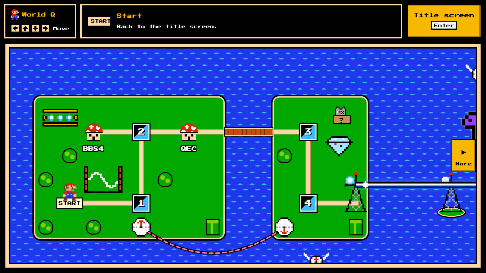
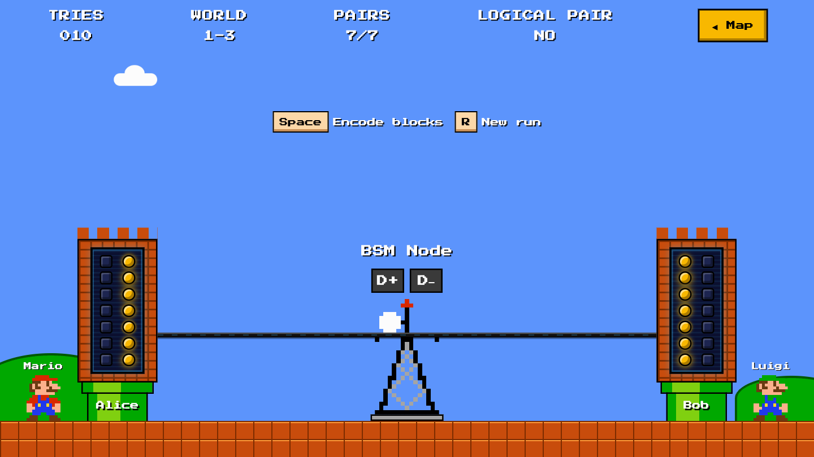
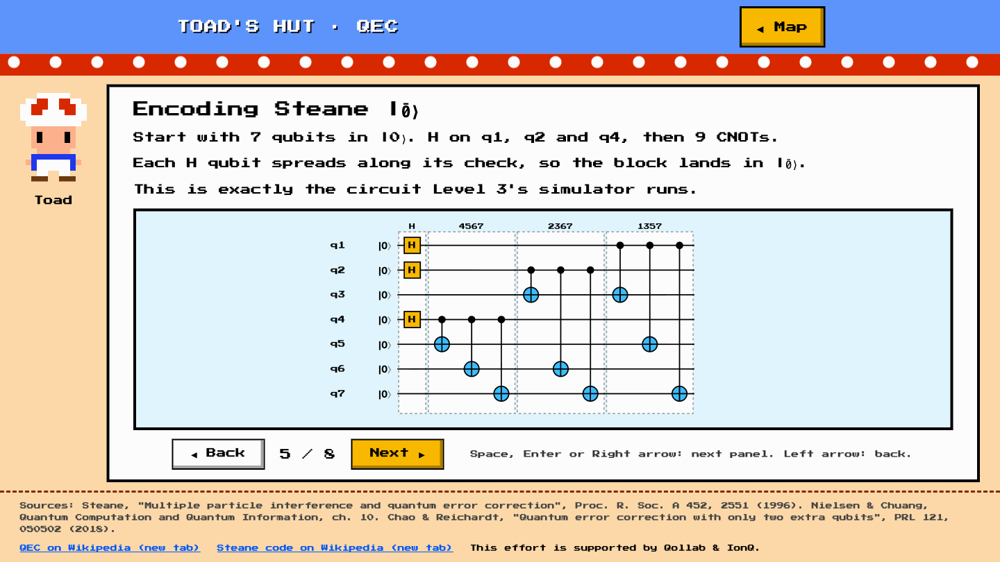
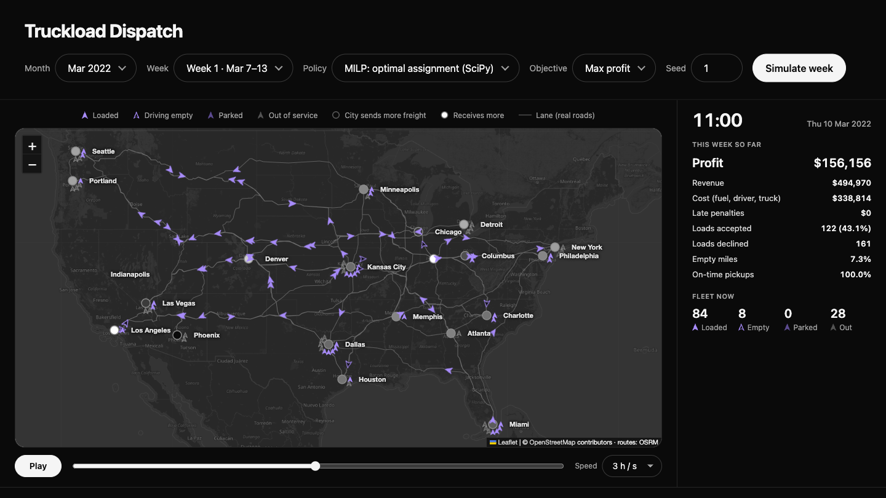
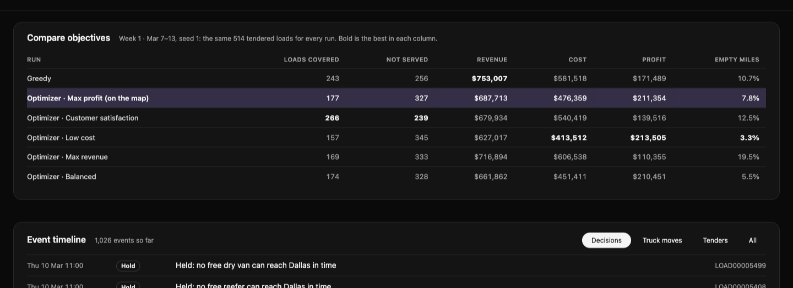

# Cartheon × Qollab × IonQ

Team Cartheon's projects for the **Qollab × IonQ Hackathon** (Oct 9–11, 2026). Each folder is its own project with
its own README.

This effort is supported by Qollab & IonQ.

---

## Quantum Bros · [Project 3](./Project_3_QuantumRepeaters_QKD/)

A Super Mario Bros. 3 style game that teaches the quantum internet. Mario and Luigi build entanglement, protect it
with the Steane code, and turn it into a secret key, while Qowser's turtles tap the fiber.



<p>
  
  
</p>

```sh
cd Project_3_QuantumRepeaters_QKD && npm run backend   # open http://localhost:8001
```

## Freight Decision Intelligence · [Project 2](./Project_2:FreightDecisionInteligence/)

A truckload dispatch simulator. Every policy (greedy, or a MILP optimizer with five objectives) dispatches the same
week of loads, so you can compare profit, coverage and empty miles head to head.





```sh
cd Project_2:FreightDecisionInteligence && npm run serve   # open http://localhost:8022
```

## Energy Grid Optimization · [Project 1](./Project_1:EnergyGridOptimization/)

Not started yet.

---

Rules every project follows: [`RULES.md`](RULES.md). All code and docs are [MIT](LICENSE).
